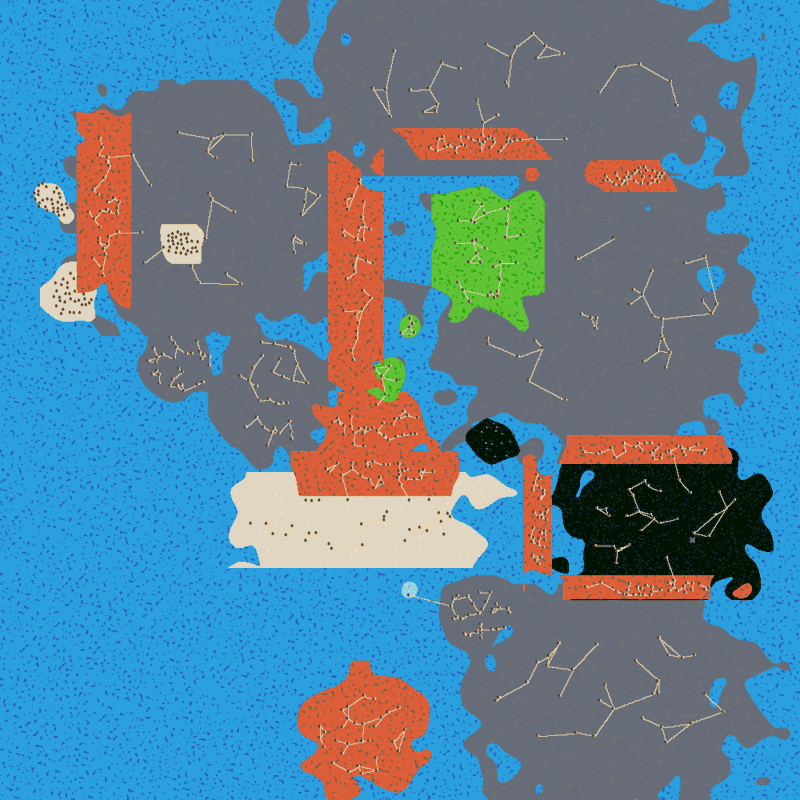

# Middle-earth Adventure: Plan & Status

> **Living document. Update it with every change**: tick off tasks, adjust the plan, and add a line to the change log.
> How to build, test and find your way around the code: [DEVELOPMENT.md](DEVELOPMENT.md).

**Goal:** a Middle-earth adventure plane for Forge's Adventure mode, using the Lord of the Rings and The Hobbit card sets, with Middle-earth regions, enemies, towns and a story.
**Scope:** stays in this fork (Tolkien IP). It will not be announced or upstreamed.

## Decisions

| # | Decision | Date |
| --- | --- | --- |
| D1 | Card pool: `LTR`, `LTC`, `PLTC` (Deluxe Commander Kit), `HOB`, `HOC`. Other Middle-earth printings are welcome when they exist as their own edition. Secret Lair LotR cards are in the shared `SLD` set and so are excluded for now. | 2026-11-13 |
| D2 | Content is built on the **random world generator first**. The fixed Tiled world (Phase 2) can be developed in parallel by a separate agent. | 2026-11-13 |
| D3 | The plane stays in the fork and isn't published. Engine changes are kept minimal and isolated so that upstream merges stay cheap. | 2026-11-13 |
| D4 | Edition restriction uses upstream's native `allowedEditions` support. The fork's earlier custom `legalCards.editions` Java code was dropped during the upstream sync. | 2026-11-13 |

## Current status (baseline after Phase 0)

`tools/middleearth/check.sh` → **0 errors, 556 warnings**. `game.sh smoke` → new game, intro and overworld all work, with no exceptions.

| Area | State |
| --- | --- |
| Card pool | ✅ 844 unique cards (LTR 836, LTC 558, HOB 321, HOC 158, PLTC 4 printings). Rewards, shops and printings are restricted correctly. |
| Biomes | 🟡 29 ME regions with hand-set positions. The layout is roughly recognisable but too much of it is grey "waste" (see image). Enemy lists are still Shandalar's. |
| Starter decks | ❌ All 30 come from common (Shandalar) decks with about 55–65% off-pool cards. |
| Enemies | ❌ 206 enemy decks spawned in the plane contain off-pool cards. 44 enemy names referenced by biomes no longer exist upstream (renamed in upstream's big adventure update), so those spawns are silently dropped. |
| Towns / POIs | ❌ Copied from Shandalar (255 POIs). `Mountain Town Erebor` is referenced but doesn't exist, so Erebor has no town. The start area is a desert packed with identical castles. |
| Shops / items / quests | ❌ Generic Shandalar content. The intro is "Welcome to Shandalar". |
| Fixed Tiled world | ❌ Not started (issue #2). The Gondor and Mordor region `.tmx` files exist. |

Baseline world (generated, north is up):

## Phases

### Phase 0: Baseline and test setup ✅

- [x] Sync with upstream Card-Forge/forge (Hobbit sets, `allowedEditions`, new planes).
- [x] Switch the plane config to `allowedEditions` and add HOB, HOC and PLTC.
- [x] Fix `config.json` for the current schema (`staringMoney` → `startingMoney`). Before this fix the plane crashed on start.
- [x] Fix the biome data: `south_gondor` had the name `northern_waste` and was listed twice in `world.json`.
- [x] Reproducible build in the cloud sandbox (`game.sh build`).
- [x] Headless data checker (`check.sh` / `PlaneCheck.java`).
- [x] Headless GUI driver and smoke test (`game.sh smoke`: Xvfb, xdotool, console).
- [x] `exportMap` console command for full-world images.
- [x] Docs: this plan and DEVELOPMENT.md.
- [x] Verified that issue #1 (printings from wrong sets) is solved by upstream's implementation. `check.sh` guards it.

### Phase 1: Middle-earth content on the random generator

Use `Innistrad/` as the template. Each item should be done when `check.sh` shows it no longer produces off-pool warnings.

1. **Starter decks**: 5 colours × (starter / constructed / pile) × difficulty, built only from LTR/HOB. Thematic examples: W = Gondor/Rohan, U = Elves/Rivendell, B = Mordor/Nazgûl, R = Dwarves/Erebor, G = Hobbits/Ents.
2. **Enemies** (plane-local `world/enemies.json` plus `decks/`):
   - Mordor and the dark side: Orc, Uruk-hai, Orc Captain, Nazgûl (boss), Mouth of Sauron, Olog-hai, Troll, Warg rider, Easterling, Haradrim, Corsair of Umbar, Barrow-wight, Shelob/spiders, Balrog (boss), Smaug (boss), goblins of the Misty Mountains, the Great Goblin.
   - Neutral and other: bandits/ruffians (Bree, Shire), Dunlendings, Huorns, wolves, Gollum, Saruman (boss).
   - Sprites: reuse existing common sprites where they fit (orc, troll, spider, dragon, wolf…). Custom sprites come later.
   - Decks are built from in-pool cards only, with a spread of difficulty ranks.
3. **Biome rework**:
   - Replace the Shandalar enemy lists with ME enemies per region.
   - Retune positions and sizes against the real map, and shrink the "waste" fill.
   - Fix the crowded start area.
   - Use `exportMap` to compare.
4. **Towns and POIs**:
   - Named towns per region: Hobbiton, Bree, Rivendell, Edoras, Helm's Deep, Minas Tirith, Osgiliath, Dale, Erebor, Lake-town, Grey Havens…
   - Dungeons: Moria, Barrow-downs, Dol Guldur, Cirith Ungol, Isengard, the Lonely Mountain.
   - Start with existing town and dungeon `.tmx` maps, renamed. Custom maps come later.
5. **Shops and items**: card shops per region and faction, and ME items (Sting, mithril shirt, elven cloak, phial of Galadriel, the One Ring as a special item).
6. **Heroes and avatars**: hobbit, human (Dúnedain/Rohirrim), elf, dwarf, wizard.
7. **Intro**: replace the Shandalar intro dialog and texts ("Welcome to Middle-earth").

### Phase 2: Fixed Tiled world (issue #2), can run in parallel

The approach from issue #2: load the Tiled world into the existing `World` data structures instead of abstracting `World`/`WorldStage`.

1. Investigate what `World.generateNew` produces (biome map, terrain, POI positions, roads, minimap) and what `WorldStage` consumes.
2. Add an opt-in `world.json` field (for example `"tiledWorld": "maps/world/middleearth/middleearth.world"`) that creates a `World` from Tiled layers: a biome or terrain layer, plus an object layer for POIs and the start position.
3. Keep random generation as the default. Keep the engine diff small (see "Engine changes").
4. Draw out the full Middle-earth map in Tiled. The Gondor and Mordor regions already exist.

### Phase 3: Story and quests

- A main quest along the Fellowship's route (Shire → Bree → Rivendell → Moria → Lothlórien → Rohan/Gondor → Mordor).
- Side quests per region. Possibly a separate *The Hobbit* storyline (Erebor, Smaug).
- Bosses with unique rewards. The One Ring is a cursed item.

## Engine changes in this fork

Keep this list complete, because it is what makes upstream merges predictable.

| Change | Files | Why |
| --- | --- | --- |
| `exportMap [file]` console command | `forge-gui-mobile/src/forge/adventure/stage/ConsoleCommandInterpreter.java` | Writes the whole generated world to a PNG for layout work and tests. |

## Known issues / backlog

- 44 enemy names in the biomes no longer exist upstream. They go away with the Phase 1 enemy rework, so they are not being remapped.
- The world generator sometimes retries POI placement ("Can not place POI Spawn…Rerunning"), once per smoke run so far. Watch this once the ME POIs exist.
- Upstream DB quirk: `Grave Researcher` (SOS) has a face named "Reanimate", which collides with the LTC *Reanimate*. This is harmless. The checker ignores it.
- `F4` (exit) in the intro cave doesn't leave the cave. Use the `leave` console command in scripts.

## Change log

| Date | Change |
| --- | --- |
| 2026-11-13 | Merged upstream master (≈9,200 commits). Dropped the fork's prototype Java changes. Plane config now uses `allowedEditions` (+HOB, HOC, PLTC). |
| 2026-11-13 | Phase 0: config schema fix, biome name and duplicate fix, test tooling (`tools/middleearth/`), `exportMap` command, DEVELOPMENT.md and this plan. Baseline: 0 errors, 556 warnings. |
