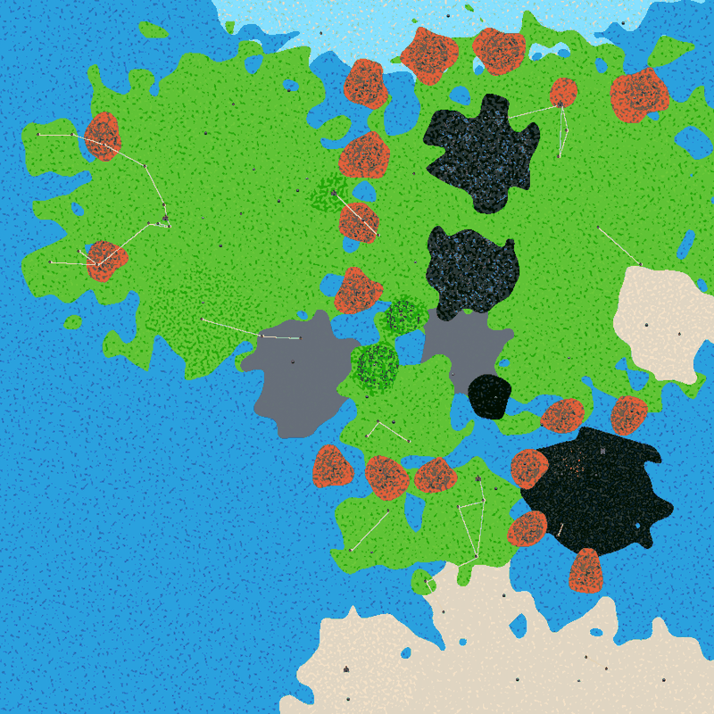
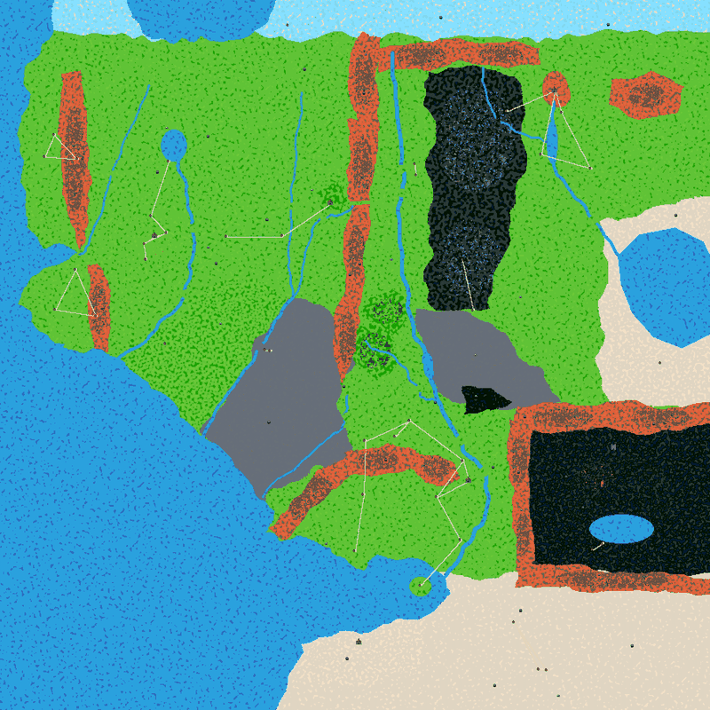

# Middle-earth Adventure: Plan & Status

> **Living document. Update it with every change**: tick off tasks, adjust the plan, and add a line to the change log.
> How to build, test and find your way around the code: [DEVELOPMENT.md](DEVELOPMENT.md).

**Goal:** a Middle-earth adventure plane for Forge's Adventure mode, using the Lord of the Rings and The Hobbit card sets, with Middle-earth regions, enemies, towns and a story.
**Scope:** stays in this fork (Tolkien IP). It will not be announced or upstreamed.

## Decisions

| # | Decision | Date |
| --- | --- | --- |
| D1 | Card pool: `LTR`, `LTC`, `PLTC` (Deluxe Commander Kit), `HOB`, `HOC`, plus the custom reprint set `MEAR` (D5). Other Middle-earth printings are welcome when they exist as their own edition. Secret Lair LotR cards are in the shared `SLD` set and so are excluded for now. | 2026-11-13 |
| D2 | Content is built on the **random world generator first**. The fixed Tiled world (Phase 2) can be developed in parallel by a separate agent. | 2026-11-13 |
| D3 | The plane stays in the fork and isn't published. Engine changes are kept minimal and isolated so that upstream merges stay cheap. | 2026-11-13 |
| D4 | Edition restriction uses upstream's native `allowedEditions` support. The fork's earlier custom `legalCards.editions` Java code was dropped during the upstream sync. | 2026-11-13 |
| D5 | A **custom reprint set** (Forge `Type=Custom` edition) adds existing non-LotR cards that fit Middle-earth (wolves, spiders, eagles, treefolk, trolls, horses, wizards…). No new artwork: each reprint reuses a fitting existing printing's art. The goal is a good Middle-earth experience, not strict LTR-only. | 2026-11-13 |
| D6 | New decks are tested **AI vs AI**. Starter decks should be about as strong as the official LTR Starter Kit decks, not stronger. Enemy decks get a strength rating that matches their spawn difficulty. | 2026-11-13 |
| D7 | Upstream enemy decks that fit Middle-earth thematically can be reused with small card swaps (off-theme or off-pool cards replaced) instead of being built from scratch. | 2026-11-13 |
| D8 | Custom (new) cards are deferred to Phase 3/4. | 2026-11-13 |
| D9 | Strength targets (from WP1). 40-card starter decks are rated with `--g40` against 40-card cuts of the two LTR Starter Kit decks (Gondor GW, Mordor BR), target **45–55%** (on-par band 42–58%). Enemy decks are rated with `--enemy-life`: <45% easy, 45–60% normal, 60–75% hard, >75% elite/boss (rough calibration). Upstream difficulty comes mostly from enemy `life`, not the deck. | 2026-11-13 |
| D11 | **Usage budget for agents** (user): routine content work (decklists, enemy and shop JSON, data entry) runs on **Sonnet**. Opus is only for engine changes and hard debugging. At most **2 agents in parallel**, and each task is sized to finish in one run (resuming an agent re-reads its whole transcript). Agents commit checkpoints often and keep reports short. Small integration steps are done by the coordinator directly. Running agents are never switched mid-task. | 2026-11-14 |
| D10 | MEAR follow-up (user): keep all 223 cards. Original dual lands and shock lands may be added. Prefer Tolkien names: cards whose names clearly don't fit get a Tolkien **flavor name**, using Forge's existing per-printing `${"flavorName": ...}` support (rules identity unchanged), or are swapped out. Tokens should get fitting art where it's cheap; small engine changes are OK, but avoid heavy workarounds. | 2026-11-14 |

## Current status (Phase 1 complete, awaiting user play-test)

`tools/middleearth/check.sh` → **0 errors, 2 warnings** (whitespace typos in upstream maps). `game.sh smoke` → new game, ME intro and overworld work. `WorldSim` → 0 placement reruns and 0 unreachable POIs over 20 seeds.

| Area | State |
| --- | --- |
| Card pool | ✅ LTR, LTC, HOB, HOC, PLTC and the custom reprint set MEAR (233 cards, 66 with Tolkien flavor names, incl. the 10 original duals; all tokens have art). |
| World layout | ✅ Fixed, deterministic world from the Tiled file `middleearth.tmx` (Phase 2b), originally generated from the Phase 2a biome map: 43 regions plus ocean, rivers, lakes/seas and fords, start in the Shire. |
| Towns / POIs | ✅ 90 POIs (about 97 placed per world). Named towns and dungeons sit at their map positions. Middle-earth town name lists per region. |
| Intro | ✅ "Welcome to Middle-earth" quest and tutorial. The wizard dialog is overridden through `MiddleEarth/languages/adventure-en-US.properties` (en-US only; the speaker title still reads "Adept Black Wizard"). |
| Starter decks | ✅ All in-pool. Constructed: 15 ME faction decks (Easy mono, Normal allied, Hard enemy pairs). Standard: official LTR Jumpstart packs. Pile: pool-filtered templates. All 15 constructed decks measure 42–59% against the LTR Starter Kits (round 2 tuning). |
| Enemies | ✅ 532 in the plane's `enemies.json`: the common copy, 34 Shadow (WP5) + 15 re-themed generics, and 34 Free Peoples/wild (WP6, merged from `enemies-free.fragment.json` with `tools/middleearth/merge-enemies.py`). All 43 biomes spawn only ME enemies (61 distinct). Town/dungeon map enemies are re-themed too. 540 entries in total. |
| Shops / items / heroes | ✅ 250 ME shops (all 243 shop names requested by the plane's maps exist), 107 items incl. 27 ME items (Sting, Mithril Coat, Andúril, The One Ring…), races Hobbit/Man/Elf/Dwarf/Wizard (reused sprites). |
| Fixed Tiled world | ❌ Not started (Phase 2). |

World after WP3 (generated, north is up):

Baseline before Phase 1: [worldmap-baseline.png](img/worldmap-baseline.png)

## Phases

### Phase 0: Baseline and test setup ✅

- [x] Sync with upstream Card-Forge/forge (Hobbit sets, `allowedEditions`, new planes).
- [x] Switch the plane config to `allowedEditions` and add HOB, HOC and PLTC.
- [x] Fix `config.json` for the current schema (`staringMoney` → `startingMoney`). Before this fix the plane crashed on start.
- [x] Fix the biome data: `south_gondor` had the name `northern_waste` and was listed twice in `world.json`.
- [x] Reproducible build in the cloud sandbox (`game.sh build`).
- [x] Headless data checker (`check.sh` / `PlaneCheck.java`).
- [x] Headless GUI driver and smoke test (`game.sh smoke`: Xvfb, xdotool, console).
- [x] `exportMap` console command for full-world images.
- [x] Docs: this plan and DEVELOPMENT.md.
- [x] Verified that issue #1 (printings from wrong sets) is solved by upstream's implementation. `check.sh` guards it.

### Phase 1: Middle-earth content on the random generator ✅ (2026-11-14, ready for play-testing)

Use `Innistrad/` as the template. Phase 1 is split into work packages (WPs). Each WP is done by one agent in its own git worktree and branch, and the coordinator merges them. Every WP touches its own set of files (listed under "Owns"). An agent writes its report to `docs/MiddleEarth/notes/<wp>.md`. Only the coordinator edits this plan.

**Wave 1 (parallel)**

| WP | Task | Owns | Status |
| --- | --- | --- | --- |
| WP1 deck-lab | AI-vs-AI strength harness built on Forge `sim` mode (`tools/middleearth/deckstrength.sh`). Reference gauntlet of the official LTR Starter Kit decks. Strength rating for decks. | `tools/middleearth/deck*`, `forge-gui/res/adventure/MiddleEarth/decks/reference/`, `notes/wp1-deck-lab.md` | ✅ ([notes](notes/wp1-deck-lab.md)) |
| WP2 reprint-set | Custom Middle-earth reprint edition (art reuse mechanism, card selection), added to `allowedEditions`, checker support. | `forge-gui/res/editions/<custom>.txt` (or the plane-local equivalent), `config.json` → `allowedEditions` only, `notes/wp2-reprint-set.md` | ✅ MEAR, 223 cards ([notes](notes/wp2-reprint-set.md)) |
| WP3 world-layout | Retune biome positions and sizes against the real map, shrink the waste, fix the start area. ME towns and POIs (names, Erebor town, dungeons from existing `.tmx`), town name lists, intro text. | `world/world.json`, biome fields other than `enemies`, `world/points_of_interest.json`, `world/town_names_*.txt`, intro/quest texts, `notes/wp3-world-layout.md` | ✅ 43 biomes, 90 POIs, ME intro ([notes](notes/wp3-world-layout.md)) |

**WP2b mearfix (parallel to Wave 2):** MEAR follow-up per D10: Tolkien flavor names, dual and shock lands, token art. ✅ 66 flavor names, 10 dual lands, 8 token art sources ([notes](notes/wp2b-mearfix.md)).

**Wave 2 (after WP1 and WP2)**

| WP | Task | Owns | Status |
| --- | --- | --- | --- |
| WP4 starter-decks | 5 colours × starter/constructed/pile × difficulty, matched to the reference strength. W = Gondor/Rohan, U = Elves, B = Mordor, R = Dwarves, G = Hobbits/Ents. | `MiddleEarth/decks/starter/`, `config.json` → `difficulties[*].*Decks` |
| WP5 enemies-shadow | Mordor, Isengard, Moria, Nazgûl, trolls, orcs/goblins, Easterlings, Haradrim, Corsairs, Balrog, Smaug, Shelob. Reuse upstream decks where they fit (D7). | `MiddleEarth/world/enemies.json` (shadow section), `MiddleEarth/decks/enemy/shadow/` |
| WP6 enemies-free | Bandits/ruffians, Dunlendings, wolves/wargs, spiders, Huorns, Barrow-wights, Gollum, Saruman, plus allied duelists (rangers, elves, dwarves). | `MiddleEarth/decks/enemy/free/` and an enemies fragment that the coordinator merges |
| WP7 shops-items-heroes | Regional and faction card shops, ME items (Sting, mithril shirt, elven cloak, phial, the One Ring), hero avatars (hobbit, human, elf, dwarf, wizard). | `world/shops.json`, `world/items.json`, `world/heroes.json`, sprites | ✅ 250 shops, 107 items (27 ME), 5 races ([notes](notes/wp7-shops-items-heroes.md)) |

**Wave 3 (integration):** ✅ biome enemy lists done by the coordinator (see change log). ✅ Generic enemies in common town/dungeon maps re-themed: 170 get ME decks, 143 get ME display names ([notes](notes/wave3-map-enemies.md), `tools/middleearth/retheme-map-enemies.py`). 8 missing capital-arena challengers added.

Original plan: fill the biome `enemies` lists with ME enemies per region (all 43 biomes; the 15 biomes added in WP3 hold verbatim copies of their parent region's Shandalar list), run a full smoke run, and play-test.
### Phase 2: Fixed world layout (issue #2)

**Phase 2a ✅ (2026-11-14):** the fixed layout comes from a biome map image, not tile-by-tile Tiled maps. `tools/middleearth/biomemap/make_biome_map.py` renders `MiddleEarth/world/biome_map.png` (900×900) from named region polygons, rivers (Anduin, Brandywine, Hoarwell, Loudwater, Greyflood, Isen, Entwash, River Running, Forest River, Lhûn), lakes and seas (Evendim, Long Lake, Nen Hithoel, Rhûn, Nurnen), the coasts, and 14 fords plus the High Pass. The script also rewrites the biome colours, bounding boxes, the 52 named POI anchors and the start position. Edit the polygons, rerun the script, then run WorldSim and smoke. See [notes](notes/phase2a-biome-map.md).

**Phase 2b ✅ (2026-11-14):** the world is now `MiddleEarth/world/middleearth.tmx` (49 KB). It holds a `Biomes` tile layer painted with `biomes.tsx` (one tile per biome), a `POI` object layer with all 97 placed POIs and their names, a `start` object and a `seed`, and it's exported once from the game with `exportWorldTmx`. Every new game builds the identical world (verified pixel- and byte-identical). The polygon script is retired; rerunning it would overwrite manual edits. How to edit: DEVELOPMENT.md §4.1, [notes](notes/phase2b-tiled-world.md).

**Phase 2 open items:**
- Open and save the tmx once in real Tiled to confirm compatibility (Tiled isn't installed in the sandbox).
- Structures (mountains, Mordor) are anchored on the biome JSON bounding boxes. When painting a biome far outside its box, update `startPointX/Y` and `width/height` (a candidate for automation).
- Optional `Roads` layer.
- Distinct tilesets per region: Shire, Eriador, Rohan and Gondor all use the Green tileset, so their borders don't show.
- Review the proportions (Lindon width, Rhûn, the Harad coast).
- Optional minor rivers.
- Bridge tiles: visible roads cross water without a bridge graphic (hidden paths no longer do, see the 2026-11-15 change log).

Original plan (superseded by 2a):

The approach from issue #2: load the Tiled world into the existing `World` data structures instead of abstracting `World`/`WorldStage`.

1. Investigate what `World.generateNew` produces (biome map, terrain, POI positions, roads, minimap) and what `WorldStage` consumes.
2. Add an opt-in `world.json` field (for example `"tiledWorld": "maps/world/middleearth/middleearth.world"`) that creates a `World` from Tiled layers: a biome or terrain layer, plus an object layer for POIs and the start position.
3. Keep random generation as the default. Keep the engine diff small (see "Engine changes").
4. Draw out the full Middle-earth map in Tiled. The Gondor and Mordor regions already exist.

### Phase 3: Story and quests

- A main quest along the Fellowship's route (Shire → Bree → Rivendell → Moria → Lothlórien → Rohan/Gondor → Mordor).
- Side quests per region. Possibly a separate *The Hobbit* storyline (Erebor, Smaug).
- Bosses with unique rewards. The One Ring is a cursed item.

## Engine changes in this fork

Keep this list complete, because it is what makes upstream merges predictable.

| Change | Files | Why |
| --- | --- | --- |
| Per-card art source for reprint editions: an edition entry may carry `${"artSet": "M10", "artNum": "185"}`. Download URLs (cardforge, Scryfall, art crop, sleeve) are built from that printing, while the image is cached under the reprint's own key. | `forge-core/.../card/CardEdition.java` (`EditionEntry.hasArtSource/getArtSourceSet/getArtSourceNumber`), `forge-gui/.../util/ImageFetcher.java` (`getArtSourcePrinting`) | Lets MEAR (D5) show a chosen existing printing's art without new artwork (WP2). |
| Token art sources: `[tokens]` lines in an edition file accept `${"artSet", "artNum"}` (the token's collector number in the source set). The Scryfall token URL is built from that set's token; the image is cached under the original key. | `forge-core/.../card/CardEdition.java` (`parseTokenParams`, token `EditionEntry` params), `forge-gui/.../util/ImageFetcher.java` (`getTokenArtSource`) | Lets MEAR tokens show existing token art (WP2b, D10). |
| Fixed biome layout: optional `WorldData.biomeMap` (image). `World.loadFixedBiomeMap()` assigns each tile's biome by exact pixel colour = biome `color` (row 0 = north; unmatched colours → first biome), with lower-index neighbours within 2 tiles for border transitions. One branch in `generateNew`; random generation is unchanged when unset. Limit: 64 biomes (bit mask). | `forge-gui-mobile/.../data/WorldData.java`, `.../world/World.java` | Phase 2a: geographically faithful Middle-earth with rivers and seas. |
| `BiomeStructure.initialize` fixes: the height loop was bounded by width (infinite loop for non-square biomes); `chunkSize()` never leaves chunks smaller than N (1-px chunks crashed `OverlappingModel` in a worker thread and `generateNew` waited forever); a failed structure leaves its chunk empty instead of indexing out of bounds. | `forge-gui-mobile/.../world/BiomeStructure.java` | Engine bug 1 from WP3, plus bugs found in Phase 2a. |
| Tiled world file: optional `WorldData.worldMap` (`.tmx`). New `world/WorldMapTmx` (read/write without GL: `XmlReader` + zlib). `World.loadWorldMap()`/`placeWorldMapPois()`: biomes from the tile layer (gid → tile property `biome`), POIs placed exactly from the `POI` object layer (`name`, `displayName`, `spriteIndex`), player start from the `start` object, generation seeded from the map's `seed`. The random POI loop is skipped. `buildBiomeMasks()` is shared with the PNG path; `drawPoiMarker()` is factored out. `exportWorldTmx [file]` console command. `PointOfInterest.get/setSpriteIndex`. The save format is unchanged. | `forge-gui-mobile/.../world/WorldMapTmx.java` (new), `World.java`, `WorldData.java`, `pointofintrest/PointOfInterest.java`, `stage/ConsoleCommandInterpreter.java` | Phase 2b: the world is fixed, deterministic and editable in Tiled. |
| Dev control API (dev only; off unless `-Dforge.devapi.port` / `FORGE_DEVAPI_PORT`): new package `forge.adventure.devapi` (`DevApi`, JSON writer; no HTTP code, so mobile-safe) and `forge-gui-mobile-dev` `forge.app.DevApiServer` (JDK HttpServer on 127.0.0.1). One line in `GameLauncher`. Small accessors: `MapStage.getMapActors()`, `AdventurePlayer.getCharacterFlags()/getQuestFlags()` (read-only), `NewGameScene.devApiStart(...)`. A few protected fields are read by reflection inside `DevApi`. | see [notes](notes/tooling-devapi.md) | Lets agents and tests drive and observe the game as text (`tools/middleearth/gamectl.py`, `tests/`). |
| No invisible water crossings in fixed layouts: when `worldMap`/`biomeMap` is set, the hidden POI-to-nearest-town paths in `World.generateNew` no longer clear collision on pure water tiles (biome mask = base/ocean only). Visible roads still cross water. | `forge-gui-mobile/.../world/World.java` | Play-test: the player could walk across the Brandywine anywhere a hidden path crossed it. |
| `god [seconds]` console command (default 3600): sprint + fly + hide for the duration, plus a full heal. For play-testing. | `ConsoleCommandInterpreter.java` | Play-test convenience. |
| `exportMap [file]` console command | `forge-gui-mobile/src/forge/adventure/stage/ConsoleCommandInterpreter.java` | Writes the whole generated world to a PNG for layout work and tests. |

## Known issues / backlog

- MEAR near-duplicates of pool cards (`notes/mear-similarity.md`): 11 tier-1 pairs. Recommended swaps await a user decision: Murder → Grasp of Darkness / Sengir Vampire, Cancel → Remand, Think Twice → Mulldrifter, Claustrophobia → another blue card. Also 13 tier-1 pairs inside MEAR itself.
- Repo-shipped custom card art for flavor-named MEAR cards needs a small engine change (plane-local `card_pics`/`token_pics` checked first; see `ARTWORK.md`). Stopgap: symlink into `~/.cache/forge/pics/cards/MEAR`.
- Spawn difficulty: overworld spawns are filtered by `difficulty <= rank` (rank 0.5 for the first 20 wins, then 1 / 2 / …). Our enemies use 0.1 = easy, 0.3–0.5 = normal (spawn from the start!), 0.6–1 = hard, and bosses. Regions near the start should list mostly 0.1 enemies. Review the other early regions (Eriador, Lindon) in play-testing. Sharkey's Ruffians currently spawn in no region.
- Dev API gaps: no plane switch in `/newGame` (use `game.sh start <plane>`); overworld walking is straight-line (no pathfinding); no shop, deck-editor or inventory endpoints; no card-level duel control. See `notes/tooling-devapi.md`.
- Saruman's deck plays weak (56% even at 38 life; the AI handles control poorly). Rework the deck. See `notes/wp5-wp6-enemies.md`.
- When `enemies-free.fragment.json` changes, regenerate with `python3 tools/middleearth/merge-enemies.py --base <enemies.json without the fragment> ...`. Simpler from now on: edit `enemies.json` directly and treat the fragment as historical.
- Side quests are an interim copy of 34 generic Shandalar side quests (Kiora's and Teferi's quests dropped). Re-theme them in Phase 3. Without them, the town job boards crashed (NPE in `AdventureQuestController.getQuestNPCResponse` on an empty side-quest list).
- The One Ring is currently sold in Umbar's black market (30,000 gold). It should become a unique boss or quest reward (WP5 / Phase 3). A "can't unequip" curse would need an engine change.
- Hobbit and Wizard races reuse farmer/peasant and wizard enemy sprites with human portraits. Proper sprites need new art.
- The wizard intro and the rune display names are en-US only (`MiddleEarth/languages/adventure-en-US.properties`).
- Generated (`.json` template) decks break down under the restricted pool (`enemy:Troll` → 32× The Lonely Mountain). The current `*_e.json` starters pull in non-ME jumpstart cards, and `check.sh` skips generated decks.
- Engine bugs found in WP3 (bug 1 was fixed in Phase 2a):
  2. `World.generateNew` road loops stop one short, so the last non-town POI gets no cleared path. Workaround: `dead_marshes` (open swamp) is the last biome.
  3. A POI with `radiusFactor` 0 always lands on the biome centre, and if that spot is taken the whole placement reruns.
  4. A POI that can't be placed in its biome after 500 tries is dropped silently.
- World generation is now 3.7–4.8 s (was 1.8 s), mostly from decoration structures (Mordor alone takes about 2.5 s).
- MEAR: the desktop bulk "download all pictures" ignores the art sources. The art choices were made without seeing the images; review them in-game with network access.
- 44 enemy names in the biomes no longer exist upstream. They go away with the Phase 1 enemy rework, so they are not being remapped.
- The world generator sometimes retries POI placement ("Can not place POI Spawn…Rerunning"), once per smoke run so far. Watch this once the ME POIs exist.
- Upstream DB quirk: `Grave Researcher` (SOS) has a face named "Reanimate", which collides with the LTC *Reanimate*. This is harmless. The checker ignores it.
- `F4` (exit) in the intro cave doesn't leave the cave. Use the `leave` console command in scripts.

## Change log

| Date | Change |
| --- | --- |
| 2026-11-15 | MEAR similarity check (`tools/middleearth/mear_similarity.py`), LTR Starter Kit reference decks verified against the user's official lists (identical, no re-measure needed), `docs/MiddleEarth/ARTWORK.md` (custom artwork how-to; plane-local pictures need an engine change). |
| 2026-11-15 | Play-test fixes: (1) rivers were walkable wherever a hidden POI path crossed them; fixed in the engine (see Engine changes) and verified with the dev API: walking east at three Brandywine rows stops at the bank. WorldSim: 0 unreachable POIs. (3) New console command `god`. (2) The early Shire was too hard: the rank-0.5 spawn filter let Ranger of the North, Sharkey's Ruffians and Bill Ferny (difficulty 0.5) spawn from the start. The Shire now spawns Hobbit Troublemakers, Southern Ruffians and Wild Wolves, plus a rare Bill Ferny (spawnRate 0.4); Black Riders (0.8) only appear after 20 wins. `run_all.sh`: ALL PASSED. |
| 2026-11-15 | Dev tooling merged (Opus agent): dev control API in the game, `gamectl.py` CLI/library, `tests/intro_walkthrough.py` regression test (passes; fails on the old quest 28), `tests/run_all.sh`, `game.sh smoke` on the API (~30 s). Duels: state, concede, autoplay. Coordinator re-ran `run_all.sh` on main: ALL PASSED. |
| 2026-11-15 | Play-test fix: the intro portal couldn't be opened. The wizard's dialog *toggles* portal 78. Shandalar's prologue closes it first, but our rewritten prologue (WP3) only did that on the New Game+ branch, so "opening" it closed it (and NG+ players were locked in). The normal prologue path now closes the portal; NG+ leaves it open. The intro wizard ("Adept Black Wizard", re-themed to "Dol Guldur Adept" by the map-enemy pass) now displays as "Wandering Wizard". Verified in the GUI: prologue → wizard → portal → Shire. |
| 2026-11-14 | Phase 2b merged (Opus agent): Tiled-editable world file with exact POIs and seed, `exportWorldTmx`, PlaneCheck/WorldSim tmx checks, DEVELOPMENT §4.1. Two smoke runs gave identical worlds; the round trip was byte-identical. check: 0 errors, 2 warnings. Main jar rebuilt. |
| 2026-11-14 | Phase 2a merged (Opus agent): fixed biome-map world with rivers and seas, `BiomeStructure` fixes (engine), WorldSim and PlaneCheck support for biomeMap. check: 0 errors, 2 warnings. WorldSim: 0 reruns/dropped/unreachable. Gen time ~2.9 s (unchanged). Main jar rebuilt. |
| 2026-11-14 | **Phase 1 complete.** Starter tuning round 2 (Sonnet agent): all 8 outliers are in the on-par band. All 68 new enemies measured (2,176 games). 17 outliers re-tuned through life/difficulty/spawnRate and re-measured. Report: `notes/wp5-wp6-enemies.md`. |
| 2026-11-14 | Wave 3 map enemies (Sonnet agent): 170 generic map enemies → ME decks, 143 ME display names. Coordinator added 8 arena challengers missing upstream (Erebor, Umbar and Rivendell capitals). check: 0 errors, **2 warnings** (whitespace typos in upstream maps; the game falls back to a biome enemy). |
| 2026-11-14 | WP4 merged (agent stopped mid-tuning; the coordinator checkpointed, re-measured and filled in the report). All 60 starter references point to `decks/starter/ME/`. check: 0 errors, 242 warnings. |
| 2026-11-14 | WP2b merged (agent stopped at the usage limit; the coordinator checkpointed, rebuilt, tested and wrote the report): 66 Tolkien flavor names, 10 original dual lands, token art sources (engine change). Main jar rebuilt. |
| 2026-11-14 | WP5 and WP6 merged (agents stopped at the usage limit before writing reports; coordinator committed their checkpoints). WP6 fragment merged into `enemies.json` (532 enemies). Wave 3: all 43 biome `enemies` lists replaced with ME enemies. check: 0 errors, 845 → 272 warnings. Smoke OK, 0 POI retries. |
| 2026-11-14 | WP7 merged: shops, items and heroes; PlaneCheck section 6 (shops, items, heroes). Coordinator fixes: added 34 generic side quests to the plane's `quests.json` (fixes the job-board NPE found by WP7) and ME display names for the six runes. |
| 2026-11-14 | User decisions on the WP2 questions recorded (D10). WP2b started. |
| 2026-11-13 | WP1 merged: `tools/middleearth/deckstrength.sh` (DeckSim worker with forced play/draw, DeckExport for .json and `enemy:` decks), LTR Starter Kit reference decks plus 40-card cuts and baselines. Measured: kits 55/45 against each other; upstream starters range 31–73%; ~2–4 s per game. Strength bands are in D9. |
| 2026-11-13 | WP3 merged: world 900×900, 43 biomes (15 new, enemy lists copied from their parent regions), 90 ME POIs, per-region town names, ME intro and tutorial quest, Oasis map path fix. Added `tools/middleearth/WorldSim.java` (offline layout simulator). Fixed the biome Y-axis note in DEVELOPMENT.md. |
| 2026-11-13 | WP2 merged: custom reprint set `MEAR` ("Middle-earth Adventure Reprints", 223 cards, C120/U70/R28/M5) with per-card art sources (engine change). Unique pool 844 → 1,067 cards. Open questions for the user are in the WP2 notes. |
| 2026-11-13 | Merged upstream master (≈9,200 commits). Dropped the fork's prototype Java changes. Plane config now uses `allowedEditions` (+HOB, HOC, PLTC). |
| 2026-11-13 | Phase 1 planned (D5–D8, work packages). Tooling made safe for parallel agents (`FORGE_JAR`, isolated game home per `OUT_DIR`, `DISPLAY_NUM`). |
| 2026-11-13 | Phase 0: config schema fix, biome name and duplicate fix, test tooling (`tools/middleearth/`), `exportMap` command, DEVELOPMENT.md and this plan. Baseline: 0 errors, 556 warnings. |
