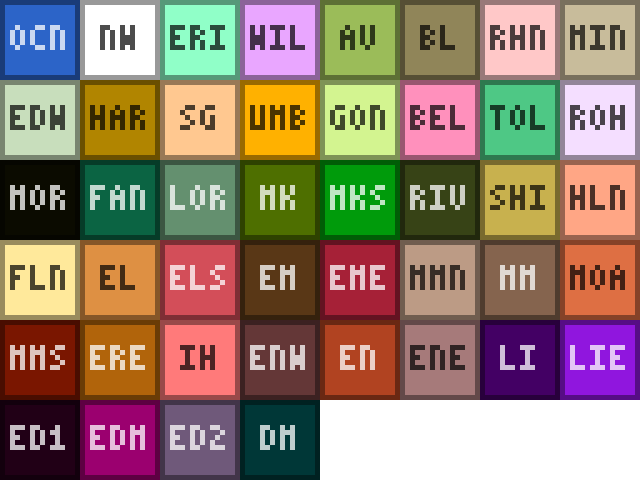
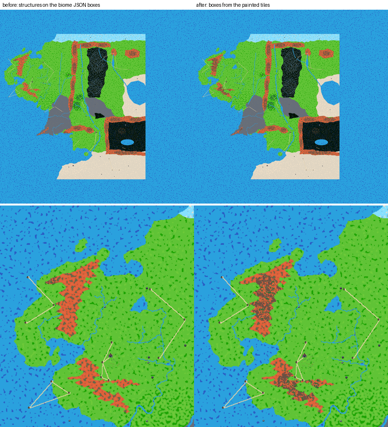

# Biome editor palette and biome boxes from the painted tiles

User feedback while hand-painting the world in Tiled:

1. *"The colors of the biomes are very similar, which makes it hard to distinguish which is the correct color of a biome."* The tileset used each biome's game `color`: the closest pair (`ephel_duath_1` / `ephel_duath_mid`) was ΔE2000 1.5 apart, and 139 pairs were below 10.
2. Can biomes be placed as objects, or used directly from the tiles? The biome **assignment** already came from the painted tiles. But the decoration structures (mountains, forests, Mordor; WFC in `BiomeStructure`) were still anchored on each biome JSON's `startPointX/Y`, `width`, `height`, so a biome painted outside its JSON box got no structures there.

Branch `biome-tools`, on top of the user's map commits `fbf72d722` and `67e79cf39`. The user's chunk files are not modified.

## Part 1: editor palette

- `world/middleearth/biome_palette.json`: `{"<biome>": {"color": "#rrggbb", "label": "SHI"}, ...}` (a plain `"#rrggbb"` value also works; keys starting with `_` are comments). `WorldMapTmx` uses it for `biomes.png` and `overview.png` and falls back to the biome `color`. The game's biome colours (minimap, `exportMap`, rendering) are unchanged: `exportMap` before and after is pixel-identical.
- Reading never uses colours. `WorldMapTmx.parseMap` maps gids to biomes by the tile property `biome` only (`gidToBiome`), and the retired `biomeMap` PNG path is the only colour-based reader. Verified: the decoded `Biomes` layers of all 64 chunks are identical between HEAD, the working tree and a game export with the new tileset (1,440,000 cells), and the smoke export's chunks are byte-identical to the export before the change.
- Tiles: 1-px darker border as before, plus a 2–3 letter label in a 3×5 pixel font (dark or light shade of the fill, readable at 16 px; e.g. `SHI`, `MM`, `ED1`). Each `<tile>` has `type="<biome>"` (Tiled ≥ 1.10 reads `type` as the tile's Class and shows it in the Properties panel; 1.9 wrote `class`). The reader ignores the attribute.
- `tools/middleearth/worldmap/make_biome_palette.py` (PEP 723: numpy) picks the colours: an sRGB grid of 24 levels per channel, filtered per family in CIELAB/LCh; ocean first (a typical water blue), then greedy max-min (the most constrained biome takes the candidate farthest in CIEDE2000 from all chosen colours), then improvement passes. Deterministic. It then calls `tools/middleearth/worldmap/BiomeTiles.java` (fat jar, headless, about 2 s), which runs the engine's own writer (`WorldMapTmx.writeBiomeImages`) and rewrites only `biomes.tsx/.png` and `overview.png`. A game `exportWorldTmx` writes byte-identical files.

| Family | Biomes | Range (CIELAB) | Closest pair inside, ΔE2000 |
| --- | --- | --- | --- |
| water | ocean | blue, L 38–50 | – |
| snow | northern_waste | white | – |
| forest | fangorn, lothlorien, mirkwood, mirkwood_south, rivendell | greens, L 22–62 | 16.3 |
| plains | eriador, wilderland, anduin_vale, rhun, minhiriath, enedwaith, gondor, belfalas, tolfalas, rohan, shire, harlindon, forlindon | light (L 72–93), any hue except orange and cyan/blue | 13.5 |
| desert | harad_waith, south_gondor, umbar, brown_lands | yellow/orange/tan | 13.8 |
| mountain | the 13 Ered Luin, Ered Mithrin, Misty Mountains, Erebor, Iron Hills, Ered Nimrais biomes | warm red/orange/brown, L 25–68 | 13.5 |
| shadow | mordor, ered_lithui(_east), ephel_duath_1/_mid/_2, dead_marshes | dark (L ≤ 22, not blue) or purple/magenta | 18.5 |

**Closest pair overall: ΔE2000 13.4** (`south_gondor` / `forlindon`), no pair below 10 (game colours: 1.5, 139 pairs below 10).

## Part 2: biome boxes from the painted tiles

- `World.loadWorldMap()` calls `applyPaintedBiomeBoxes(worldMap)` right after `WorldMapTmx.read`, so before the WFC futures in `generateNew`. For every biome it takes the bounding box of its painted tiles (`WorldMapTmx.biomeBoxes`, [x][row], row 0 = north, the same axis as biome `startPointY`) and sets `startPointX/Y`, `width`, `height` (`WorldMapTmx.boxFractions`). The fractions are chosen so that `generateNew`'s integer maths, `left = round(startPointX·W) − round(width·W)/2`, gives back exactly the painted box (`startPointX = (minX + w/2)/W`, `width = w/W`). Unpainted biomes keep their JSON values (logged), and so does a biome with `width = height = 1` (the full-world ocean base). Without a `worldMap` nothing changes (Shandalar starts and generates as before).
- Only structure placement uses the box with a world map: the biome painting loop already covers the whole world for fixed maps, and the random POI placement (`offsetX/Y`) is skipped.
- `generateNew` logs `worldMap: biome boxes from the painted tiles, N differ from the biome JSON`, and warns for a biome with structures whose box exceeds 400×400 tiles. There is no cap: a capped box would leave painted tiles without structures.
- `check.sh` (PlaneCheck) reports how many JSON boxes differ from the painted ones (`-v` lists them, e.g. `ered_luin: JSON 73,239 44x227, painted 81,272 99x141`) and warns about huge structure boxes. `tools/middleearth/worldmap/sync_biome_boxes.py` (standard library) writes the painted boxes into the biome JSONs, editing only the four top-level numbers in place (not the `structures` entries' `width/height`) and checking each file's result with the game's float/rounding maths. Run once: **23 biome JSONs synced**. Afterwards `check.sh` and the game both report 0 differences, and the smoke world is identical to the one from the unsynced JSONs.
- WorldSim doesn't replicate structures or boxes for a world map (it only does for random generation, which is unchanged), so it needed no change.

Biggest box changes (the user's painting): `ered_luin` 44×227 → 99×141, `ered_luin_south` 31×113 → 132×100, `ered_nimrais_west` 107×106 → 212×60 (3 painted pieces, 14% of the box), `harlindon` 96×111 → 34×63, `forlindon`, `eriador`, `northern_waste` 835 → 578 wide. Most others moved by one tile (the old JSON boxes were rounded from the 900-tile world).

Top: whole world (`exportMap`), before and after. Bottom: Lindon and Ered Luin. Before, the mountain structures covered only part of the painted Ered Luin; now they fill it.

**BiomeStructure with odd boxes** (direct test of `BiomeStructure.initialize`, seed 42, no exceptions in any case):

| Box (tiles) | mountain.png (Misty Mountains) | black.png (Mordor) |
| --- | --- | --- |
| 42×119 | 60 ms | 167 ms |
| 3×500 (thinner than N) | 2 ms, empty | 0 ms, empty |
| 1200×8 | 28 ms | 325 ms |
| 40×1200 | 114 ms | 1.5 s |
| 600×600 | 0.6 s | 10.5 s |
| 1200×1200 | 2.1 s | 40 s |

Time grows with the box area, and `black.png` is the expensive one. Hence the warning at 400×400.

## Engine changes (rows for PLAN.md → "Engine changes")

| Change | Files | Why |
| --- | --- | --- |
| Editor palette: `WorldMapTmx` reads an optional `biome_palette.json` next to the world map (`readPalette`, `paletteFor`) and draws `biomes.png` and `overview.png` in its colours with a 3×5-font label per tile; each tileset tile gets `type="<biome>"`. `writeBiomeImages` rewrites only the tileset and the overview (used by `tools/middleearth/worldmap/BiomeTiles.java`). Game colours and reading are unchanged. | `forge-gui-mobile/.../world/WorldMapTmx.java` | Biome tiles that can be told apart in Tiled (user feedback). |
| Biome boxes from the painted tiles: `World.applyPaintedBiomeBoxes` (called in `loadWorldMap`, before the structures) sets each painted biome's `startPointX/Y`, `width`, `height` to the bounding box of its tiles; the JSON is a fallback for unpainted biomes; the full-world base biome is kept; warns about structure boxes > 400×400. Helpers `WorldMapTmx.biomeBoxes/boxFractions/boxOf`. Random generation is unchanged. | `.../world/World.java`, `.../world/WorldMapTmx.java` | Structures follow the painting; no manual JSON box edits. |

Tools: `make_biome_palette.py`, `BiomeTiles.java`, `sync_biome_boxes.py` (new, `tools/middleearth/worldmap/`); PlaneCheck box report; `game.sh smoke` no longer fails when `gamectl state | head` closes the pipe (BrokenPipe under `pipefail`, which aborted the smoke run before the exports).

## Tests

| Test | Result |
| --- | --- |
| Build (`game.sh build`, `DISPLAY_NUM=118`) | OK |
| `check.sh` | 0 errors, 2 warnings (the old upstream map typos); `0 biome JSON boxes differ` after the sync |
| WorldSim | 0 unreachable POIs, **`problems: 8`**: all `OUTSIDE BIOME` (POIs that now stand in ocean or a neighbouring biome after the user's painting, e.g. Grey Havens, Elf-haven, Lond Galen, Thorin's Halls). Identical with the baseline build on the same map, so they come from the map edits, not from this change. Not fixed (POIs are the user's data). |
| Chunk data | 64/64 chunks: decoded `Biomes` identical (HEAD, working tree, game export); chunk files untouched in git |
| Game colours | `exportMap` after Part 1 pixel-identical to the baseline |
| Tileset round trip | `exportWorldTmx` writes `biomes.tsx/png` and `overview.png` byte-identical to `BiomeTiles.java` |
| Determinism | Two smoke runs after Part 2: `smoke-world/` identical (`diff -r`), `smoke-worldmap.png` identical; also identical before and after the JSON sync |
| Decorations | 165,052 of 23 M `exportMap` pixels changed (structures where the boxes changed), as intended |
| Generation time | 4.13 s before, 3.90 / 4.43 / 4.46 s after (run-to-run noise; Mordor `black.png` 1.58 → 1.43 s) |
| `tests/run_all.sh` | ALL PASSED |
| Shandalar (random generation) | starts, no exceptions, no world map log line |

`.me-test/smoke-worldmap-before.png` and `.me-test/smoke-worldmap.png` hold the before/after maps (gitignored).

## Open questions

- **Stray tiles:** `ered_nimrais_west` (3 pieces, 1,200 + 537 + 13 tiles, 14% of its box) and `ered_luin_south` (2 pieces, 25%) have sparse boxes. If the small pieces are stray paint, the structures stretch over the gap (they only appear on that biome's tiles, but the WFC pattern is spread over the box). Worth a look in Tiled.
- **POIs outside their biome** (WorldSim): 8 POIs now stand on ocean or another biome after the repainting; the user may want to move them or repaint.
- The palette's light plains colours (13 biomes) are the tightest family. If one pair still looks too close in Tiled, pin colours by hand in `biome_palette.json` and rerun with `--keep`.
- Tiled check on a real machine: labels at 16 px and the Class shown per tile (Tiled 1.10+).
