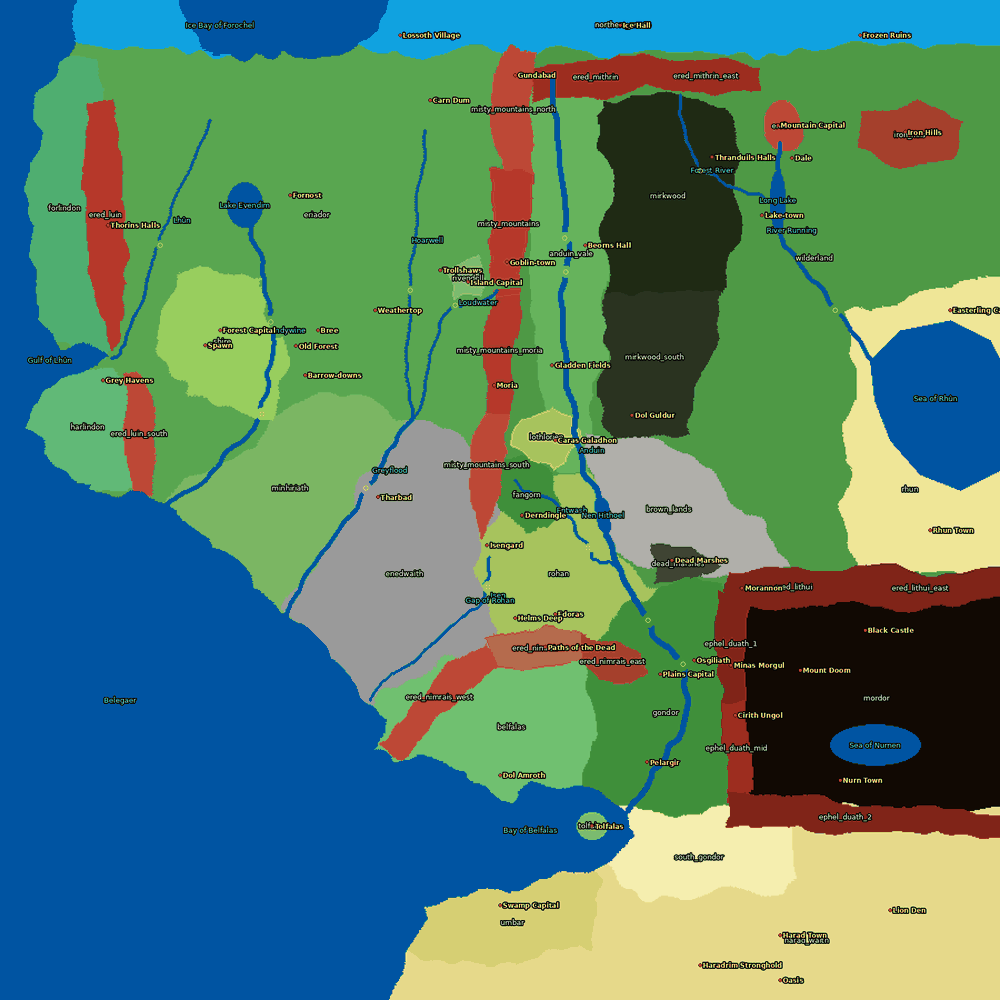
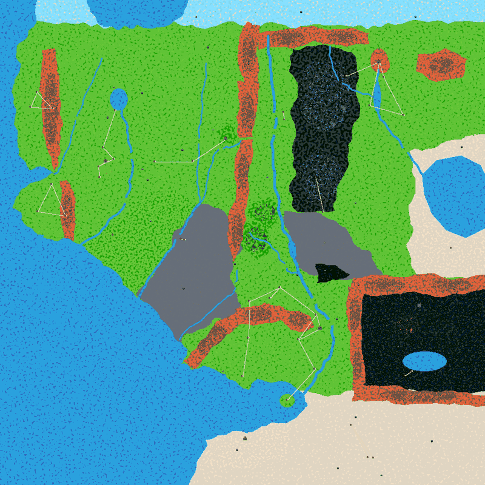
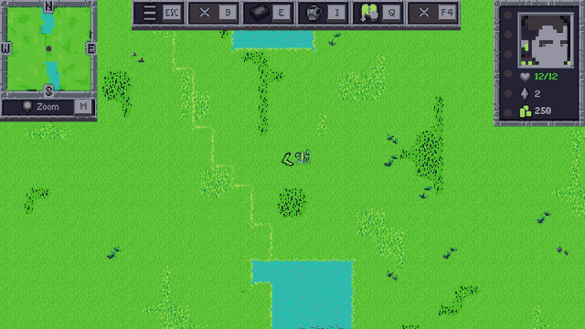

# Phase 2a: fixed world layout from a biome map

Branch `worktree-agent-a68a405d77ee953f3`. The Middle-earth world layout is now fixed. Every tile's biome comes from `MiddleEarth/world/biome_map.png` (900×900, one pixel per tile). That image is generated from polygons, rivers and lakes in `tools/middleearth/biomemap/make_biome_map.py`. Random generation is still the default for every plane that doesn't set `biomeMap`.

| Biome map (labelled preview) | Generated world (`exportMap`) |
| --- | --- |
|  |  |

Brandywine Bridge in the overworld (the river with its ford gap, and the transition tiles between biomes):



## Design

- **Engine (opt-in):** a new `WorldData.biomeMap` field. When it is set, `World.generateNew` takes each tile's biome membership from the image instead of from noise, start points and radius. Everything downstream is unchanged and reads the same `biomeMap` bit masks: terrain variants, WFC structures, POI placement, roads, the minimap, map sprites and enemy spawns.
- **Colour → biome:** an exact RGB match against each biome's existing `color` field. A colour that matches no biome falls back to the first biome (`base.json`, the ocean). All 44 biome colours are now unique (`BIOME_COLORS` in the script).
- **Water:** the sea, lakes and rivers all use the ocean biome (`Base` water tiles, collision). No dedicated water biome is needed: rivers 2–4 tiles wide render cleanly with the autotile edges (see the screenshot above).
- **Bounding boxes:** the engine still anchors WFC structures and POI placement on a biome's `startPointX/Y` and `width/height`. The script writes each biome's **pixel bounding box** into those fields, so structures cover the biome's real extent, and POI offsets are computed against that box.
- **Fords and passes:** roads already cross water (a road tile clears collision and is drawn over the water), and the hidden POI-to-town paths also clear collision. On top of that, the map leaves land gaps at the named crossings: Brandywine Bridge, Sarn Ford, Fords of Isen, Osgiliath, Cair Andros, the Carrock ford, the Old Ford, Tharbad, the Last Bridge, the Ford of Bruinen, Entwade, the Elvenking's bridge, a Celduin ford and a Lhûn ford. The High Pass is a land strip through the Misty Mountains. The Gap of Rohan is open by layout.

## Engine change (for PLAN.md → "Engine changes")

| Change | Files | Why |
| --- | --- | --- |
| Opt-in fixed biome layout. When `world.json` sets `"biomeMap": "<image>"`, `World.generateNew` paints biomes from the image. The new helper `World.loadFixedBiomeMap()` builds one bit mask per tile: the tile's own biome (exact RGB match on the biome `color`, otherwise biome 0); biome 0, which underlies everything as in random generation; and every lower-index biome within 2 tiles, so that borders draw as transitions over the neighbouring biome rather than over water. Image row 0 is north, and the image is sampled nearest-neighbour if its size differs from the world. In the biome loop, the only branch is `inBiome = mask bit set` instead of the noise/distance test (the noise is not evaluated). Unset means the old code path, unchanged. | `forge-gui-mobile/.../data/WorldData.java` (field `biomeMap`), `forge-gui-mobile/.../world/World.java` (`loadFixedBiomeMap`, one branch in `generateNew`) | Phase 2a fixed layout with rivers and inland seas. |
| `BiomeStructure.initialize` fixes: (1) the height loop used `targetWidth` as its bound (PLAN engine bug 1, an infinite loop for biomes wider than tall); (2) the new `chunkSize()` never leaves a last WFC chunk smaller than `N`, because `OverlappingModel.graphics` threw `ArrayIndexOutOfBounds` on 1-pixel chunks, the thread died, and `generateNew` then **waited forever** for that structure; (3) `dataMap` is pre-filled with -1, and a chunk whose WFC fails stays empty (`continue`) instead of indexing past the array and returning early. For sizes that worked before, the behaviour is identical. | `forge-gui-mobile/.../world/BiomeStructure.java` | Non-square bounding boxes from the biome map triggered (1) and (2). The first smoke run hung in world generation. |

The square-biome workaround from WP3 is no longer needed (PLAN known issue 1 is fixed). Engine bugs 2–4 are untouched. They are harmless with the fixed map: every named POI has an anchor inside its biome, and 0 POIs were dropped over 20 seeds.

## Map as code: `tools/middleearth/biomemap/make_biome_map.py`

```bash
python3 tools/middleearth/biomemap/make_biome_map.py            # PNG + preview + plane data
python3 tools/middleearth/biomemap/make_biome_map.py --no-data  # PNG + preview only (try-out)
```

- Coordinates are world fractions, with x = 0 west and **y = 0 north** (image rows), the same as biome `startPointY`.
- **Layers**, where later wins: `LANDS` (broad lands first, then regions), `MOUNTAINS`, `PASSES` (land restored), `SEAS` (Belegaer coast with the Gulf of Lhûn, the Bay of Belfalas and Umbar; the Ice Bay of Forochel), `ISLANDS` (Tolfalas), `LAKES` (Evendim, Long Lake, Nen Hithoel, the Sea of Rhûn, the Sea of Nurnen), `RIVERS` (Anduin, Brandywine, Hoarwell, Loudwater, Greyflood, Isen, Entwash, River Running, Forest River, Lhûn, each with a width in tiles) and `FORDS` (land restored). Each region is a named constant.
- Region and coast edges get a seeded smooth domain warp (lands ±9, mountains ±6, coast ±10 tiles), and rivers get a seeded meander, so the output is reproducible.
- **`POI_ANCHORS`**: name → (x, y, spread). The script writes `offsetX/offsetY/radiusFactor` into `points_of_interest.json` so that the engine places the POI within `spread` of the anchor, and it checks that the anchor area lies in the POI's biome. It writes `playerStartPosX/Y` from the `Spawn` anchor (the Shire). POIs that aren't listed keep their random placement around the bounding-box centre.
- **Checks** (`!!` lines, non-zero exit): biomes without pixels, anchors outside their biome, and land not covered by any region (apart from stray coast pixels).
- **Writes:** `world/biome_map.png`, `.me-test/biome_map_preview.png` (labelled, 2×), biome `color` and boxes (a targeted text replace, so the files keep their formatting; it verifies the top-level fields), the POI anchors, and `world.json` (`biomeMap`, start position).

### How to edit the map

1. Edit the polygons, rivers, fords or anchors in the script. Run it with `--no-data` and look at `.me-test/biome_map_preview.png`.
2. Run it without `--no-data`. It should report `problems: 0`.
3. `java -cp $J tools/middleearth/WorldSim.java forge-gui/res/adventure/MiddleEarth 0 .me-test/sim.png 20`: aim for 0 reruns, 0 dropped and 0 unreachable POIs.
4. `tools/middleearth/check.sh` (the new biomeMap check: the image exists, its size matches, every colour maps to a biome, no biome shares a colour, every biome has pixels).
5. `DISPLAY_NUM=… tools/middleearth/game.sh smoke`, then look at `.me-test/smoke-worldmap.png`.

## Tools

- **WorldSim** honours `biomeMap` with the same masks as the engine (`loadFixedBiomeMap` replica, image read with ImageIO). It now also reports a stricter reachability: over land and town roads only, without the invisible POI-to-town paths that also cross water.
- **PlaneCheck** has the biomeMap section described above.

## Test results

| Test | Result |
| --- | --- |
| `check.sh` | 0 errors, 2 warnings (unchanged: the upstream map whitespace typos). `biomeMap world/biome_map.png: 900x900, 44 colours, 44/44 biomes painted`. |
| WorldSim, 20 seeds | 0 reruns, 0 dropped, 0 unreachable POIs (0 also over land and roads only). 97 POIs per world. |
| Smoke (MiddleEarth) | New game, intro and overworld work. Start in the Shire next to Hobbiton. 0 POI retries, no exceptions (only the usual `forge.preferences` and `releases.atom` noise). |
| Smoke (Shandalar, random generation) | Unchanged random world, no exceptions. |
| Overworld spot checks (`teleport to <px> <px>`) | Brandywine Bridge ford, Anduin at Osgiliath, Misty Mountains edge: transitions draw correctly over the neighbouring biome. |

World generation time (`Generating world took`, same machine, other agents running):

| | Runs | Breakdown of the last run |
| --- | --- | --- |
| Before (WP3, random) | 2.53 s, 2.83 s | biomes 1.95 s (WFC Mordor 1.4 s), minimap 0.33 s, sprites 0.19 s |
| After (biome map) | 3.62 s, 2.93 s, 2.83 s | biomes 2.07 s, minimap 0.24 s, sprites 0.20 s |

So the time is about the same, within the run-to-run noise of a shared machine. The first run after a build was the slowest (3.62 s). Mask building is part of "biomes in total" and isn't timed separately. The new map is 73% land (ocean 26.6%).

## Open issues

- **Hand-editing:** the PNG is generated, so edits belong in the script. Painting directly in a paint tool or in Tiled would work for the engine, but the next script run would overwrite it, and the biome boxes and POI offsets wouldn't follow. Possible later step: let the script read an optional hand-painted overlay PNG, or import polygons from a Tiled object layer.
- **Water collision:** rivers are ocean tiles with collision. The engine's hidden POI-to-town paths clear collision along straight lines, which also crosses rivers and lakes. The player can walk on the water there without seeing a bridge (this already happened at coasts with random generation). Roads look like causeways over water. Proper bridge tiles would need an engine change.
- **Biome identity in tiles:** many biomes share a tileset (Green for the Shire, Eriador, Rohan, Gondor…), so on the minimap the borders between them are only visible through decoration, structures and enemies. Distinct tilesets per region would be a content task.
- The proportions follow the LotR general map from memory, squeezed into a square world. Some placements can be argued (Lindon's width, Rhûn's extent, the Harad coast). The Mere of Dead Men, Gilraen, Glanduin, Limlight, Snowbourn and the Carnen are not drawn.
- WFC structures still use the biome bounding box with the structure's mask, so the dark Mordor ring and the mountain clusters fill the central part of each box, not exactly the polygon. The polygon still clips them.
- `DEVELOPMENT.md` §4: I replaced the "keep biomes square" bullet with a biome-map bullet. The coordinator may want to reword it.
