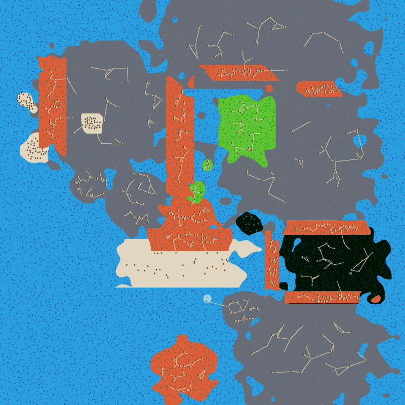
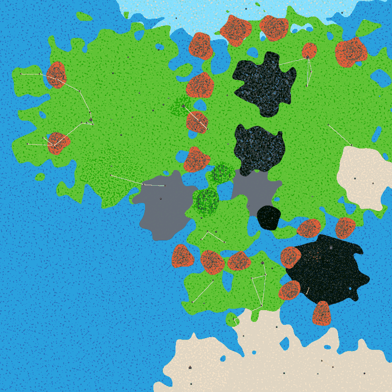
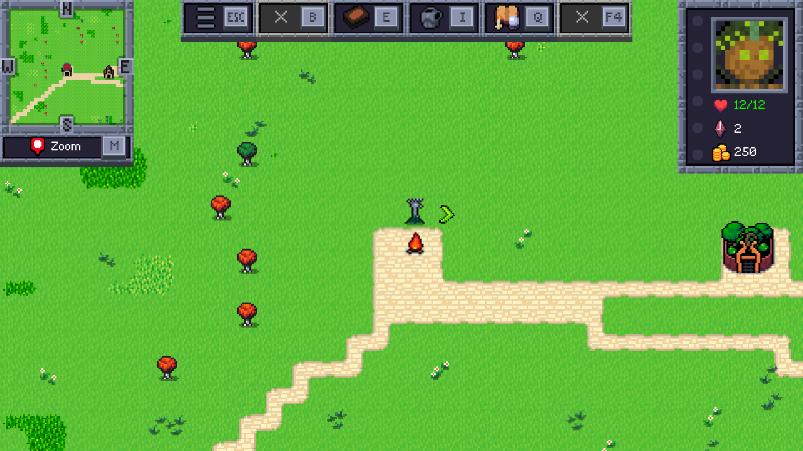

# WP3 world-layout

Branch `worktree-agent-ad9a27821540c3498`. Data-only (no Java changes).

| Baseline | After WP3 |
| --- | --- |
|  |  |

Start area (overworld, next to the start hollow; Hobbiton is just to the east):

## What changed

**World** (`world/world.json`)
- 900×900 tiles (was 1000×1000). Ocean (`base.json`) is still the filler, but it now only shows as the Belegaer in the west, the Bay of Belfalas and a few inland lakes. The grey "waste" (Colorless) is down to Enedwaith/Dunland and the Brown Lands/Emyn Muil (~3 % of the map, was ~40 %).
- `playerStartPosX/Y` = 0.215 / 0.685 (the Shire). The player is moved to the `Spawn` POI at game start anyway; the start position only clears terrain.
- `maxRoadDistance` 1000 → 1400 so neighbouring towns are linked more often.

**Biomes** (`world/biomes/`): 43 biomes (was 29). `enemies` arrays untouched (byte-identical blocks in existing files).
- All positions and sizes reworked against the Third Age map; tilesets changed where they did not fit: the Shire, Lindon, Eriador, Rohan, Gondor are green grass (Shire was sand, Rohan and Umbar were mountain tiles), Mirkwood is dark (Black) forest, Forodwaith snow (Blue), Harad/Harondor/Umbar/Rhûn sand (White), mountains Red.
- Overworld decoration: biome `spriteNames` per region type (trees in forests, rocks in mountains, cacti in Harad, flowers in the Shire…) and WFC `structures` from common: mountain clusters in every mountain blob, forest in Fangorn/Lórien, dark forest in Mirkwood, dead land + Mount Doom volcano in Mordor, small groves in the Shire and Rivendell.
- **Shape technique.** A biome is painted where `noise·noiseWeight + dist/R·distWeight < 1`, with `R = max(w,h)/2`, clipped to its w×h box. So an elongated biome always gets straight, clipped long sides (the orange bars of the baseline). All biomes are now square; long features are chains of round blobs (Misty Mountains = 4 blobs, Ered Luin 2, Ered Nimrais 3, Ered Lithui 2, Ephel Dúath 3, Ered Mithrin 2, Mirkwood 2). Forodwaith and Harad are huge circles centred *off the map* (`startPointY` −0.44 / 1.48) with low noise weight, so only their wavy rim is on the map – that gives organic northern and southern coasts.
- Painting order = priority: broad lands first, then regions, then mountains. `dead_marshes` is deliberately last (see engine bugs).
- **New biomes** (each a copy of its parent's `enemies` array, unchanged – the enemy integration has to fill these too):

  | New biome | enemies copied from |
  | --- | --- |
  | `anduin_vale`, `brown_lands`, `rhun` | `wilderland` |
  | `belfalas` | `gondor` |
  | `mirkwood_south` | `mirkwood` |
  | `rivendell` | `eriador` |
  | `ered_luin_south` | `ered_luin` |
  | `ered_mithrin_east` | `ered_mithrin` |
  | `misty_mountains_north`, `misty_mountains_moria`, `misty_mountains_south` | `misty_mountains` |
  | `ered_nimrais_west`, `ered_nimrais_east` | `ered_nimrais` |
  | `ered_lithui_east` | `ered_lithui` |
  | `ephel_duath_mid` | `ephel_duath_1` |

  No biome was removed or renamed (biome `name`s unchanged, `harad_waith` included).

### Coordinate convention (important)

Biome `startPointX/Y` and the coordinates below are fractions of the world with **Y = 0 at the north** (top of the map): `World.java` paints `biomeMap[x][y]` with `y = startPointY·height` and `getBiome(x, y)` reads `biomeMap[x][height − y − 1]`. `playerStartPosY` is the opposite (world coordinates, **Y = 0 south**). DEVELOPMENT.md §4 says "Y = 0 is the bottom (south)" for biomes – that is wrong and should be corrected by the coordinator. POI `offsetY` is also in world coordinates (positive = north).

### Region table

x, y = biome centre (y = 0 north), size = width = height.

| File | Name | Tileset | x, y | Size | POIs |
| --- | --- | --- | --- | --- | --- |
| northern_waste.json | `northern_waste` (Forodwaith) | Blue | 0.620, -0.440 | 1.2 | Lossoth Village, Frozen Ruins (dungeon), Ice-bound Hall (dungeon) |
| eriador.json | `eriador` | Green | 0.305, 0.290 | 0.52 | Bree, generic town x2, Barrow-downs (dungeon), Old Forest (cave), Weathertop (dungeon), Trollshaws (cave), Fornost Ruins (dungeon), Carn Dum (dungeon), Ruffian Camp (dungeon), Wolf Den (cave) |
| wilderland.json | `wilderland` (Rhovanion) | Green | 0.765, 0.320 | 0.64 | Dale, Lake-town, generic town x2, Warg Den (cave) |
| anduin_vale.json | `anduin_vale` | Green | 0.575, 0.340 | 0.26 | Beorn's Hall, generic town x1, Gladden Fields (cave) |
| brown_lands.json | `brown_lands` | Colorless | 0.645, 0.490 | 0.17 | Emyn Muil (cave) |
| rhun.json | `rhun` | White | 0.930, 0.450 | 0.2 | generic town x1, Easterling Camp (dungeon) |
| minhiriath.json | `minhiriath` | Green | 0.285, 0.450 | 0.19 | generic town x1, Brigand Cave (cave) |
| enedwaith.json | `enedwaith` | Colorless | 0.425, 0.525 | 0.21 | Tharbad, generic town x1, Dunlending Hold (dungeon) |
| haradwaith.json | `harad_waith` | White | 0.760, 1.480 | 1.33 | generic town x2, Haradrim Stronghold (dungeon), Lion's Den (dungeon), Oasis (cave) |
| south_gondor.json | `south_gondor` (Harondor) | White | 0.660, 0.835 | 0.19 | generic town x1, Haradrim Camp (dungeon) |
| umbar.json | `umbar` | White | 0.500, 0.930 | 0.19 | Umbar (capital), Corsair Fort (dungeon) |
| gondor.json | `gondor` | Green | 0.655, 0.725 | 0.21 | Minas Tirith (capital), Pelargir, generic town x2, Osgiliath (dungeon) |
| belfalas.json | `belfalas` | Green | 0.525, 0.745 | 0.16 | Dol Amroth, generic town x1, Sea Cave (cave) |
| tolfalas.json | `tolfalas` | Green | 0.590, 0.815 | 0.05 | Tolfalas |
| rohan.json | `rohan` | Green | 0.560, 0.580 | 0.22 | Edoras, Helm's Deep, generic town x1, Isengard (dungeon), Uruk-hai Camp (dungeon) |
| mordor.json | `mordor` | Black | 0.830, 0.690 | 0.25 | Barad-dur (castle), Mount Doom (dungeon), generic town x2, Orc Camp (dungeon) |
| fangorn.json | `fangorn` | Green | 0.530, 0.515 | 0.09 | Derndingle (cave) |
| lothlorien.json | `lothlorien` | Green | 0.565, 0.445 | 0.08 | Caras Galadhon |
| mirkwood.json | `mirkwood` | Black | 0.675, 0.215 | 0.19 | Thranduil's Halls, Spider Nest (dungeon), Spider Hollow (cave) |
| mirkwood_south.json | `mirkwood_south` | Black | 0.655, 0.375 | 0.17 | Dol Guldur (dungeon), generic town x1 |
| rivendell.json | `rivendell` | Green | 0.462, 0.272 | 0.07 | Rivendell (capital) |
| shire.json | `shire` | Green | 0.215, 0.315 | 0.15 | Wizard's Hollow (start), Hobbiton (capital), generic town x3 |
| harlindon.json | `harlindon` | Green | 0.090, 0.375 | 0.13 | Grey Havens, generic town x1 |
| forlindon.json | `forlindon` | Green | 0.075, 0.205 | 0.12 | generic town x2 |
| ered_luin.json | `ered_luin` | Red | 0.140, 0.195 | 0.08 | Thorin's Halls |
| ered_luin_south.json | `ered_luin_south` | Red | 0.145, 0.360 | 0.075 | generic town x1, Abandoned Mine (cave) |
| ered_mithrin.json | `ered_mithrin` | Red | 0.600, 0.075 | 0.09 | Orc-hold (cave) |
| ered_mithrin_east.json | `ered_mithrin_east` | Red | 0.700, 0.070 | 0.09 | Withered Heath (cave) |
| misty_mountains_north.json | `misty_mountains_north` | Red | 0.510, 0.120 | 0.085 | Mount Gundabad (cave), Eagles' Eyrie (dungeon) |
| misty_mountains.json | `misty_mountains` | Red | 0.510, 0.215 | 0.085 | Goblin-town (cave) |
| misty_mountains_moria.json | `misty_mountains_moria` | Red | 0.505, 0.315 | 0.085 | Moria (dungeon), Caradhras (dungeon) |
| misty_mountains_south.json | `misty_mountains_south` | Red | 0.500, 0.410 | 0.085 | Mountain Cave (cave) |
| erebor.json | `erebor` | Red | 0.785, 0.135 | 0.06 | Erebor (capital) |
| iron_hills.json | `iron_hills` | Red | 0.900, 0.130 | 0.1 | Iron Hills, Deep Mine (cave) |
| ered_nimrais_west.json | `ered_nimrais_west` | Red | 0.465, 0.655 | 0.075 | Mountain Cave (cave) |
| ered_nimrais.json | `ered_nimrais` | Red | 0.540, 0.665 | 0.075 | Paths of the Dead (dungeon) |
| ered_nimrais_east.json | `ered_nimrais_east` | Red | 0.610, 0.665 | 0.07 | - |
| ered_lithui.json | `ered_lithui` | Red | 0.785, 0.585 | 0.075 | Black Gate (dungeon) |
| ered_lithui_east.json | `ered_lithui_east` | Red | 0.875, 0.585 | 0.075 | Orc Camp (dungeon) |
| ephel_duath_1.json | `ephel_duath_1` | Red | 0.735, 0.655 | 0.07 | Minas Morgul (dungeon) |
| ephel_duath_mid.json | `ephel_duath_mid` | Red | 0.740, 0.740 | 0.07 | Cirith Ungol (cave) |
| ephel_duath_2.json | `ephel_duath_2` | Red | 0.820, 0.800 | 0.075 | Cave of Shadows (cave) |
| dead_marshes.json | `dead_marshes` | Black | 0.685, 0.555 | 0.08 | Dead Marshes (cave) |

## Towns and POIs (`world/points_of_interest.json`)

90 entries (was 255), ~97 placed POIs per world (was ~717).
- **Named places** have `count: 1`, a small `radiusFactor` and `offsetX/Y` computed from a target map position, so they land where they belong on the real map (spread ≈ ±1–2 % of the world).
- **Capitals keep their POI names** (`Plains Capital` etc.) because the capital rune items teleport by name; only `displayName` changed: Hobbiton (Forest, G), Rivendell (Island, U), Minas Tirith (Plains, W), Erebor (Mountain, R – fixes the missing `Mountain Town Erebor`), Umbar (Swamp, B).
- Town colours follow WP4 (W Gondor/Rohan/Dale, U elves, B Mordor/Umbar/Dunland/Rhûn, R dwarves/Harad, G hobbits/Beorn/Woodmen, colorless Bree/Tharbad/Eriador). All town maps are the existing common `*_town_generic/identity/tribal.tmx`, so shops/inns work as before.
- Generic towns per region take names from **`town_names_<biome name>.txt`** – the engine looks the file up by *biome name*, not by colour, so the old `town_names_white/blue/…` files were never used (ME towns had no names). They were replaced by per-region lists (17 files).
- Dungeons reuse common maps chosen by theme: Barrow-downs = `graveyard_5` (wights), Weathertop = `graveyard_3` (wraiths), Old Forest = `evilgrove_4` (cursed forest), Trollshaws = `cave_21` (trolls), Goblin-town = `cave_goblin`, Moria = multilevel `cave_16` (goblins, a demon at the bottom), Dol Guldur = `magetower_12` (lich), Isengard = `fort_colorless_7` (corrupted wizards), Paths of the Dead = `crypt_3`, Cirith Ungol = `cave_spider`, Minas Morgul = `magetower_6` (skeleton host + necromancer), Mount Doom = `lavaforge_1`, Barad-dûr = the common Black Castle, Corsair Fort = `fort_blue_1_pirate`, Caradhras = `snowabbey_2` (frost titans), Osgiliath = `barbariancamp_orc`… The enemies inside these maps are still upstream ones (WP5/WP6 territory).
- Removed: all Shandalar-specific entries (planeswalker lairs, Phyrexian sites, the other 4 Chapter-1 castles, quest dungeons, 30× generic towns). Kept `DEBUGZONE` (referenced by engine code).
- Fixed a pre-existing broken path: the Oasis map is `naktamun/oasis.tmx`.

## Intro (plane-local, no common files touched)

- `world/quests.json` (already plane-local): quest 28 is now "Welcome to Middle-earth" (wake in a hollow under a hill in the Shire, an old wizard in a grey cloak…). The end-of-intro choice "I want to explore Middle-earth (brief tutorial)" issues quest 30, which the plane did **not** define before (the tutorial was silently missing). Quest 30 "Where Am I?" is added, adapted from Shandalar's (town → leave town → dungeon + cave + win a duel → back to town), without the Shandalar follow-up quest 43.
- The cave dialog lives in common `spawn.tmx`, but each node has a `loctext` key, and the game loads `<plane>/languages/adventure-<lang>.properties` as an override bundle. New `MiddleEarth/languages/adventure-en-US.properties` overrides all wizard lines ("Well met, {name}. You slept a long while under this hill… You are in the Shire…"). Verified in game (screenshots in `.me-test/wiz1.png`, `wiz2.png`). Coins, rune and portal actions are unchanged and work. Limits: only applies when the game language is en-US (other languages see the Shandalar text); the speaker title is still "Adept Black Wizard" (comes from the map object's enemy name in `spawn.tmx`).
- Spawn POI display name: "Wizard's Hollow".

## Tests

- `tools/middleearth/check.sh`: **0 errors, 0 POI warnings** (baseline 1: `Mountain Town Erebor`). Total warnings 743 (baseline 556): the extra ones are "unknown enemy" warnings duplicated into the 15 new biomes from their parents' enemy lists – they disappear with the enemy rework.
- Offline simulator (exact replica of `World.generateNew` biome painting + POI placement using the engine's `OpenSimplexNoise`, plus a land/road reachability flood fill from the spawn): 300 random seeds → 0 POI reruns, 0 silently dropped POIs, 0 unreachable POIs. (Not committed; it lives in the agent scratchpad. Worth turning into `tools/middleearth/WorldSim.java` if the coordinator wants it.)
- `game.sh smoke` ×3 (+2 manual runs): all reached the overworld, **0 "Can not place POI" retries** (baseline: 7 retries of `Spawn` in one run), no exceptions besides the known `forge.preferences` and `releases.atom` noise. World generation 3.7–4.8 s (baseline 1.8 s; the extra time is the WFC structures, mostly Mordor's dead-land ring ≈ 2.5 s). Layout identical in shape across runs (random noise only moves the edges).

## Engine bugs found (not fixed)

1. `BiomeStructure.initialize`: the inner loop is `for (my = 0; my < targetWidth; my += min(targetHeight - my, MAX))` – it uses `targetWidth` as the bound. For a structure whose biome is wider than tall, `my` stops advancing at `targetHeight` → infinite loop. All biomes with structures are therefore square here.
2. `World.generateNew` roads: `for (i = 0; i < notTowns.size() - 1; i++)` (and the same for towns) skips the last element, so the last placed non-town POI never gets its collision-free path to the nearest town and can be walled in. Worked around by making `dead_marshes` (open swamp, no structures) the last biome.
3. POIs with `radiusFactor` 0 (Spawn, capitals) are always placed at the exact biome centre; if that spot is taken, all 500 tries fail the same way → full "Rerunning" loop. That was the baseline's `Spawn` retries. All ME POIs now have a non-zero `radiusFactor`.
4. If a POI's 500 random tries never hit its own biome, it is dropped silently (no log). The simulator checks for this.

## Open issues / ideas for Phase 2

- No rivers (Anduin, Brandywine, Isen) and no inland seas; the random generator can't draw lines. In the fixed Tiled world these are the main thing missing.
- Coastlines and blob outlines still have noise artefacts and small inland lakes; mountain chains are rows of blobs.
- Lindon is small relative to Ered Luin; Forodwaith is a thin band.
- Generic towns all use the same 5 town maps; named towns (Bree, Edoras, Minas Tirith…) deserve own `.tmx` maps.
- Shop lists inside the common town maps reference shop names that the plane's `shops.json` does not have (`*BoosterPackShop`, `Faerie`, `Ninja`, `Everything`…); pre-existing, for WP7.
- The capitals' item shops sell runes named after colours ("Forest rune" → Hobbiton, etc.); WP7 could rename them.
- Language override covers en-US only; add `adventure-<lang>.properties` for other languages if needed.
- Phase 2 can take the region table above as the target layout.
